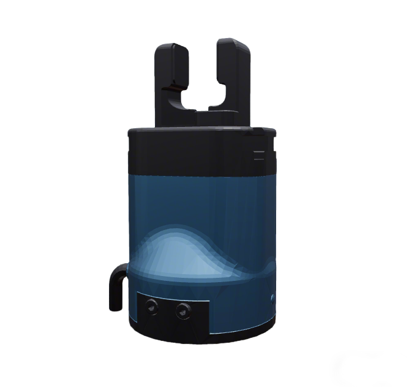

# DH-Robotics Gripper and Dexterous Hand Descriptions

This package contains URDF/Xacro and meshes for DH-Robotics PGC grippers and the
DH-3-7 three-finger, seven-joint dexterous hand.

## 1. Build

```bash
cd ~/ros2_ws
colcon build --packages-up-to dh_description --symlink-install
```

## 2. Visualize the Gripper

* PGC_140_50 Gripper (default pad)
  ```bash
  source ~/ros2_ws/install/setup.bash
  ros2 launch robot_common_launch gripper.launch.py gripper:=dh type:=PGC_140_50
  ```
  

* PGC_140_50 Gripper (dexforce pad)
  ```bash
  source ~/ros2_ws/install/setup.bash
  ros2 launch robot_common_launch gripper.launch.py gripper:=dh type:=PGC_140_50-dexforce
  ```

## 3. Visualize the DH-3-7

Build this package in the ROS 2 workspace, then source its environment:

```bash
colcon build --packages-select dh_description --symlink-install
source install/setup.bash
```

Right hand (`direction:=-1`):

```bash
ros2 launch robot_common_launch hand.launch.py hand:=dh type:=dh_3_7 direction:=-1
```

Left hand (`direction:=1`, the default):

```bash
ros2 launch robot_common_launch hand.launch.py hand:=dh type:=dh_3_7 direction:=1
```

The shared launch starts RViz and the joint-state publisher GUI. Use its seven
sliders to check the zero pose, finger axes, joint directions and limits. The
RViz fixed frame is `hand_base`. This visualization does not communicate with
the physical hand.

### Reusable model macro

```xml
<xacro:include filename="$(find dh_description)/xacro/dh_3_7.xacro"/>
<xacro:DH3_7 name="right_hand" direction="-1" fixed_joints="false"/>
```

`name` prefixes every link, joint and material; an empty name produces
`hand_base` and the unprefixed joint names below. A nonempty name produces, for
example, `right_hand_hand_base` and `right_hand_thumb_joint1`.
`fixed_joints="true"` replaces all seven revolute joints with fixed joints for
planning descriptions. Mounting to an arm requires a separately defined fixed
joint and a verified mounting transform; no flange or mount geometry is invented.

### Joint names and limits

Joints follow the existing `thumb_jointN`, `index_jointN`, `middle_jointN`
convention used by other dexterous hands (for example XHand1). The vendor
first, second and third finger chains are named thumb, index and middle.
Links follow `hand_<finger>_linkN`. With `name="right_hand"`, joints become
`right_hand_thumb_joint1`, etc.

| Vendor right / left joint | Xacro joint (before name prefix) | Right limits (rad) | Left limits (rad) |
|---|---|---|---|
| `F1R_Joint` / `LF1R_Joint` | `thumb_joint1` | 0 to 3.14 | -3.14 to 0 |
| `F11_Joint` / `LF11_Joint` | `thumb_joint2` | 0 to 3.14 | -3.14 to 0 |
| `F12_Joint` / `LF12_Joint` | `thumb_joint3` | 0 to 3.51 | -3.51 to 0 |
| `F21_Joint` / `LF21_Joint` | `index_joint1` | 0 to 3.14 | -3.14 to 0 |
| `F22_Joint` / `LF22_Joint` | `index_joint2` | 0 to 3.51 | -3.51 to 0 |
| `F31_Joint` / `LF31_Joint` | `middle_joint1` | 0 to 3.14 | -3.14 to 0 |
| `F32_Joint` / `LF32_Joint` | `middle_joint2` | 0 to 3.51 | -3.51 to 0 |

All joints use a velocity limit of **5 rad/s** and retain the vendor effort limit
of **10 N m**. The left `LF21_Joint` velocity was corrected from 51 to 5 at the
user's request. Origins, axes, masses, inertias, damping and friction otherwise
retain the vendor values. Physical joint directions and limits await visual
validation; these are the supplied model limits, not new measured limits.

### Asset provenance

- Left: user-provided `UDH3_7L.zip`, URDF
  `UDH3_7L_0903/urdf/UDH3_7L_0903.urdf`.
- Right: user-provided `UDH3_7R.zip`, URDF
  `UDH3_7R_0903/urdf/UDH3_7R_0903.urdf`.
- Left archive SHA-256:
  `3d97fb83ad216f2d9c18b90c7aaee0e51f4333df421de12644c5e1f040a16b7f`.
- Right archive SHA-256:
  `93fceaff51c00e1b0df721e44b2e616c30f1da4fb1157bdc99f9cb9948927dbd`.

Each side has eight original, unmodified STL files in
`meshes/dh_3_7/{left,right}/`. Visual and collision geometry use the original
meshes at scale 1. Left/right geometry and kinematics remain independent,
including the vendor's small wrist-origin differences. Original `base_link`
becomes `hand_base` without changing its coordinate frame. The models use the
original gray material; mesh conversion, repainting and simplified collision
geometry are deferred until visual validation.

### Confirmed device behavior for later driver integration

The following behavior was verified with the connected right hand and is used
by the `modbus_ros2_control/DH3_7RS485Hardware` plugin described below.

- Position values 0 to 5000 represent normalized travel, with 0 at the end of
  homing and 5000 at maximum travel; do not interpret them as millimeters.
  The planned angle conversion divides each URDF joint range into 5000 parts;
  zero poses, axis mapping and directions still need model validation.
- After power-on, first read initialization status. If all seven 2-bit fields
  of `0x0201` equal 1 (`0x1555`), skip homing. Otherwise, when not already
  initializing, one `0x0100 = 0x2AAA` command was sufficient. Wait for all seven
  axes to report initialized and arrived; do not automatically append `0x15AA`
  or use a fixed delay as the completion condition.
- Homing can briefly report run state 2 or `0xFFFF`. Neither is completion;
  continue monitoring initialization, run state and fault codes.
- A single custom `0x6A` frame can set seven position, speed or target-force
  parameters. One `0x69` frame reads seven positions; 50 Hz polling was verified.
- Target speed is a percentage. Target force is a percentage in the documented
  range 20 to 100, not measured joint torque in N m. Runtime percentages do not
  replace the URDF velocity/effort limits.


## 4. DH-3-7 ROS 2 Control

The standalone control entry is `xacro/ros2_control/hand.xacro` with
`config/ros2_control/dh_3_7.yaml`. It uses the existing BasicJointController,
with seven position commands in radians. Named open/close switching is disabled
until suitable grasp presets have been validated. `home_1` is the all-zero
joint pose; it is a controller pose, not the hardware's power-on initialization.

Build the hardware, asset and controller packages in the workspace:

```bash
colcon build --packages-select modbus_ros2_control dh_description basic_joint_controller --symlink-install
source install/setup.bash
```

Mock right hand (does not connect a serial device):

```bash
ros2 launch basic_joint_controller hand.launch.py \
  hand:=dh type:=dh_3_7 direction:=-1 hardware:=mock_components
```

Real right hand (activation can home the hand if initialization is incomplete):

```bash
ros2 launch basic_joint_controller hand.launch.py \
  hand:=dh type:=dh_3_7 direction:=-1 hardware:=real \
  serial_port:=/dev/serial/by-id/usb-FTDI_FT232R_USB_UART_BG036HL0-if00-port0
```

For the left hand use `direction:=1`. Default slave ID is **1 for either side**;
set `slave_id` explicitly if the device has a different ID. The supplied left
model is supported mathematically; physical communication was validated on the
right hand only. `use_rviz:=false` supports terminal-only operation.

Activation checks faults and initialization, sends at most one `0x2AAA` homing
command when needed, waits for completion, reads all seven maximum travel
values, applies speed and force percentages with readback, then seeds commands
from measured positions. An already initialized hand is not homed again.
Startup never sends an enable request or `0x15AA`.

The speed and target force defaults are both **100%**, independently of the
URDF limits. CLI overrides use ratios:

```bash
# Add to the real-hand launch above to select 50% speed and 80% target force:
# tool_velocity:=0.5 tool_torque:=0.8
```

| Hardware parameter | Default | Meaning |
|---|---|---|
| `serial_port` | `/dev/ttyUSB0` | Serial path; stable `/dev/serial/by-id/` paths are supported |
| `baudrate` | `115200` | 115200 or 921600, 8N1 |
| `slave_id` | `1` | Device ID, 1 to 254 |
| `background_period_ms` | `20` | Background polling period; independent of controller-manager rate |
| `feedback_timeout_ms` | `50` | Whole serial-transaction timeout |
| `homing_timeout_ms` | `90000` | Startup homing deadline; no automatic retry |
| `feedback_stale_timeout_ms` | `500` | Reject commands and return an error when feedback is too old; set in hardware Xacro if needed |
| `tool_velocity` | `1.0` | Speed ratio, 0.01 to 1.0; also a runtime hardware-node parameter |
| `tool_torque` | `1.0` | Target force ratio, 0.2 to 1.0; also a runtime hardware-node parameter |

After the controller is active, select MoveJ and send angles in this order:
`thumb_joint1`, `thumb_joint2`, `thumb_joint3`, `index_joint1`, `index_joint2`,
`middle_joint1`, `middle_joint2`.

```bash
ros2 topic pub --once /fsm_command std_msgs/msg/Int32 "data: 4"
ros2 topic pub --once /hand_joint_controller/target_joint_position \
  std_msgs/msg/Float64MultiArray "data: [1.57, 0.0, 0.0, 0.0, 0.0, 0.0, 0.0]"
```

For the right hand, the example corresponds to raw positions
`[2500, 0, 0, 0, 0, 0, 0]` when maximum travel is 5000. Left-hand joint angles
have the opposite sign. Conversion uses `angle_at_max` on each control joint,
so raw zero always maps to angle zero, including negative-range left joints.
Joint names are matched by suffix, allowing reordered control declarations
and `left_hand_` / `right_hand_` prefixes.

The runtime hardware parameters live on its framework-managed node (use
`ros2 node list` to find the node if launching in a namespace):

```bash
ros2 param set /dh_3_7_system tool_velocity 0.5
ros2 param set /dh_3_7_system tool_torque 0.8
```

Parameter
updates are sent by the serial worker and read back before changed position
commands are sent. Accepted ROS parameter updates are requests, not proof of
successful device application; serial/readback failures are reported by the
hardware plugin.

The hardware exports position (rad), velocity estimated using feedback timestamps
(rad/s), and unavailable effort (`NaN`). Target force percentage and current are
not presented as measured joint torque. A single serial worker owns all traffic:
`read()` and `write()` only exchange snapshots. Unchanged targets are not resent;
under load the latest target replaces queued targets. Each position read also
checks main fault and initialization in the same `0x69` frame. Detailed axis
faults are polled once per second. Three consecutive failed cycles or stale
feedback cause the hardware to return an error; no automatic rehoming occurs
in the motion loop.

`xacro/ros2_control/side_systems.xacro` also provides the reusable
`dh_3_7_rs485_side_system` macro. Robot mounting, EEF type resolution and W2
controller-registry wiring are a later integration step.
