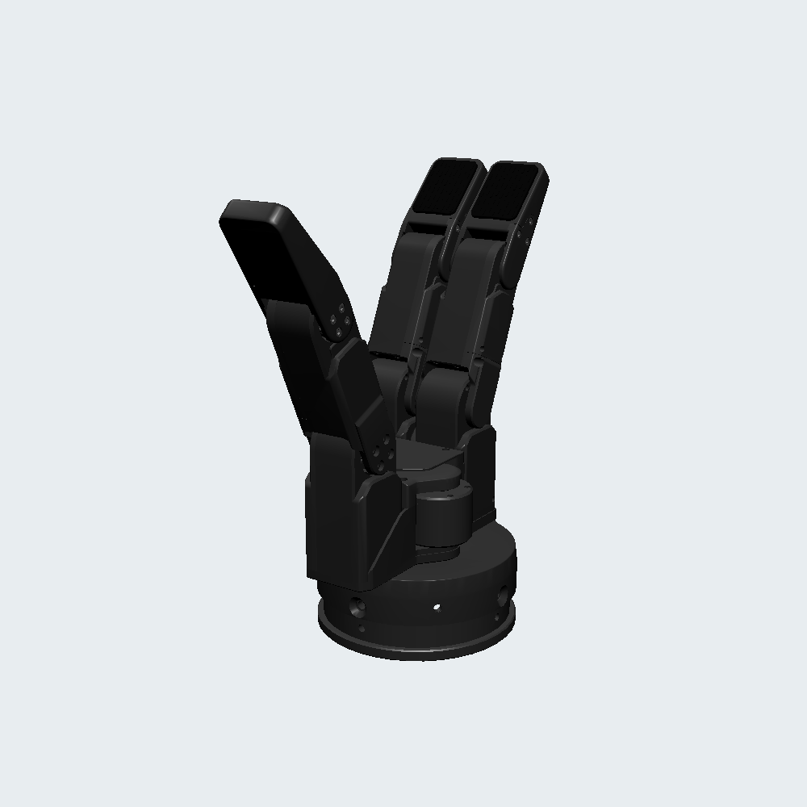

# DH-Robotics Gripper and Dexterous Hand Descriptions

URDF/Xacro, meshes and control configurations for PGC grippers and the DH-3-7
three-finger, seven-joint dexterous hand.

## 1. Build

Run from the ROS 2 workspace root:

```bash
colcon build --packages-select dh_description --symlink-install
source install/setup.bash
```

## 2. Visualize the Gripper

PGC_140_50 with default pads:

```bash
ros2 launch robot_common_launch gripper.launch.py gripper:=dh type:=PGC_140_50
```


PGC_140_50 with Dexforce pads:

```bash
ros2 launch robot_common_launch gripper.launch.py gripper:=dh type:=PGC_140_50-dexforce
```

## 3. Visualize the DH-3-7

Right hand:

```bash
ros2 launch robot_common_launch hand.launch.py hand:=dh type:=dh_3_7 direction:=-1
```

Left hand:

```bash
ros2 launch robot_common_launch hand.launch.py hand:=dh type:=dh_3_7 direction:=1
```

The launch opens RViz and a seven-joint slider GUI. The fixed frame is
`hand_base`. It does not connect to the physical hand.



### Model macro

```xml
<xacro:include filename="$(find dh_description)/xacro/dh_3_7.xacro"/>
<xacro:DH3_7 name="right_hand" direction="-1" fixed_joints="false"/>
```

| Parameter | Default | Meaning |
|---|---|---|
| `name` | Required; may be empty | Prefix for link and joint names |
| `direction` | `1` | `1` selects left; `-1` selects right |
| `fixed_joints` | `false` | Replace finger revolute joints with fixed joints |

An empty name produces `hand_base` and unprefixed joints. With
`name="right_hand"`, the root is `right_hand_hand_base` and joints are named
`right_hand_thumb_joint1`, etc. Links follow `hand_<finger>_linkN` before the
prefix. Arm integration requires a fixed mounting joint and mounting transform.

### Joint names and limits

| Vendor right / left joint | Joint name | Right limits (rad) | Left limits (rad) |
|---|---|---|---|
| `F1R_Joint` / `LF1R_Joint` | `thumb_joint1` | 0 to 3.14 | -3.14 to 0 |
| `F11_Joint` / `LF11_Joint` | `thumb_joint2` | 0 to 3.14 | -3.14 to 0 |
| `F12_Joint` / `LF12_Joint` | `thumb_joint3` | 0 to 3.51 | -3.51 to 0 |
| `F21_Joint` / `LF21_Joint` | `index_joint1` | 0 to 3.14 | -3.14 to 0 |
| `F22_Joint` / `LF22_Joint` | `index_joint2` | 0 to 3.51 | -3.51 to 0 |
| `F31_Joint` / `LF31_Joint` | `middle_joint1` | 0 to 3.14 | -3.14 to 0 |
| `F32_Joint` / `LF32_Joint` | `middle_joint2` | 0 to 3.51 | -3.51 to 0 |

All joints have a velocity limit of **5 rad/s** and an effort limit of
**10 N m**. These model limits are independent of the device's speed and
force percentage settings.

## 4. DH-3-7 ROS 2 Control

Plugin: `modbus_ros2_control/DH3_7RS485Hardware`.

The standalone entry is `xacro/ros2_control/hand.xacro`, using
`config/ros2_control/dh_3_7.yaml` and BasicJointController. Build the required
packages:

```bash
colcon build --packages-select modbus_ros2_control dh_description basic_joint_controller --symlink-install
source install/setup.bash
```

Mock right hand:

```bash
ros2 launch basic_joint_controller hand.launch.py \
  hand:=dh type:=dh_3_7 direction:=-1 hardware:=mock_components
```

Real right hand:

```bash
ros2 launch basic_joint_controller hand.launch.py \
  hand:=dh type:=dh_3_7 direction:=-1 hardware:=real
```

Use `direction:=1` for the left hand and `use_rviz:=false` for terminal-only
operation. Configure the serial port, baudrate and slave ID in
`xacro/ros2_control/hand.xacro` for the connected device;
`serial_port` also accepts stable `/dev/serial/by-id/` paths. The default slave
ID is **1 for either side**.

### Startup and homing

Real-hardware activation may move the hand. It checks faults and initialization
before accepting position commands:

1. If initialization status `0x0201` is `0x1555`, skip homing.
2. If homing is already in progress, monitor it without resending.
3. Otherwise, send one `0x0100 = 0x2AAA` homing command.
4. Wait for all seven axes to report initialized and arrived, stable for one
   second, within `homing_timeout_ms`.
5. Read maximum travel, apply speed and target force with readback, and initialize
   position commands from measured positions.

Transient homing run states other than arrived are not completion. Faults or a
homing timeout fail activation. The motion loop does not automatically rehome.

### Parameters

Speed and target force both default to **100%**. Ratios are used in the hardware
configuration and runtime parameters.

| Parameter | Default | Meaning |
|---|---|---|
| `serial_port` | `/dev/ttyUSB0` | Serial device path |
| `baudrate` | `115200` | 115200 or 921600, 8N1 |
| `slave_id` | `1` | Device ID, 1 to 254 |
| `background_period_ms` | `20` | Polling period, independent of controller-manager rate |
| `feedback_timeout_ms` | `50` | Serial-transaction timeout |
| `homing_timeout_ms` | `90000` | Startup homing timeout |
| `feedback_stale_timeout_ms` | `500` | Feedback age limit; configured in hardware Xacro |
| `tool_velocity` | `1.0` | Speed ratio, 0.01 to 1.0; runtime update supported |
| `tool_torque` | `1.0` | Target force ratio, 0.2 to 1.0; runtime update supported |

To update a running hand to 50% speed and 80% target force:

```bash
ros2 param set /dh_3_7_system tool_velocity 0.5
ros2 param set /dh_3_7_system tool_torque 0.8
```

Use the namespaced hardware node path when applicable. The serial worker applies
and reads back parameter changes; communication failures are reported by the
hardware plugin.

### Position commands and feedback

The joint order is `thumb_joint1`, `thumb_joint2`, `thumb_joint3`, `index_joint1`,
`index_joint2`, `middle_joint1`, `middle_joint2`. Select MoveJ and send radians:

```bash
ros2 topic pub --once /fsm_command std_msgs/msg/Int32 "data: 4"
ros2 topic pub --once /hand_joint_controller/target_joint_position \
  std_msgs/msg/Float64MultiArray "data: [1.57, 0.0, 0.0, 0.0, 0.0, 0.0, 0.0]"
ros2 topic echo /joint_states
```

Device positions represent normalized travel: zero is the homed position, and
maximum travel corresponds to the joint's full angular range. With maximum
travel 5000, the right-hand example corresponds to raw position 2500 on axis 1.
Left-hand joint angles have the opposite sign. Conversion uses each control
joint's signed `angle_at_max` and the maximum travel read from the device.

The hardware exports position (rad), estimated velocity (rad/s), and unavailable
effort (`NaN`). Target force percentage is not measured torque. A position update
uses one `0x6A` frame; feedback uses one `0x69` frame, with 50 Hz polling by
default. Unchanged targets are not resent. Faults, repeated communication failures
or stale feedback cause a hardware error.

The supplied configuration disables open/close preset switching. `home_1` is an
all-zero controller pose, separate from hardware power-on initialization.
`xacro/ros2_control/side_systems.xacro` provides the reusable
`dh_3_7_rs485_side_system` macro for robot integration.

## 5. Robot Integration

Select the hand with `type:=dh_3_7`, or configure each side with
`left_type:=dh_3_7` / `right_type:=dh_3_7`. Use `none` for a bare arm.

| Robot key | Arm driver |
|---|---|
| `fiveages_w2` | Marvin |
| `fiveages_w2r` | Rokae or INEX |
| `fiveages_s2` | Marvin |
| `fiveages_s2r` | Rokae or INEX |
| `fiveages_wce3` | Rokae |

The hand connects through **USB-RS485 only**, using drive type `usb` or
`usb_rs485`. Each side has a separate serial device and hardware system.
Arm-end RS485, CAN and Ethernet are not supported for this hand.

Visualize a W2R with two hands:

```bash
ros2 launch robot_common_launch humanoid.launch.py \
  robot:=fiveages_w2r type:=dh_3_7
```

Mock control:

```bash
ros2 launch ocs2_arm_controller split_body.launch.py \
  robot:=fiveages_w2r type:=dh_3_7 hardware:=mock_components
```

Real W2R with INEX arms and USB-RS485 hands:

```bash
ros2 launch ocs2_arm_controller split_body.launch.py \
  robot:=fiveages_w2r type:=dh_3_7 hardware:=real \
  hardware_arm_hardware_driver:=inex \
  hardware_left_ee_drive_type:=usb hardware_right_ee_drive_type:=usb
```

Use `hardware_arm_hardware_driver:=rokae` for Rokae arms on W2R/S2R.
Serial settings can be stored in `robot.local.yaml` and loaded with
`robot_profile:=/path/to/robot.local.yaml`:

```yaml
defaults:
  end_effectors:
    type: dh_3_7
hardware:
  left_ee_drive_type: usb
  right_ee_drive_type: usb
  usb_left_port: /dev/ttyUSB0
  usb_right_port: /dev/ttyUSB2
  usb_baudrate: 115200
  left_ee_modbus_slave_id: 1
  right_ee_modbus_slave_id: 1
```

The controller names are `left_hand_controller` and `right_hand_controller`.
Each controls seven joints prefixed with `left_hand_` or `right_hand_`, in the
axis order listed in section 4. Right-hand controller poses are
`home_1: [0.0, 1.0, 2.0, 1.0, 2.0, 1.0, 2.0]` and
`home_2: [0.0, 1.87, 1.7, 1.87, 1.7, 1.87, 1.7]`; left-hand poses use
the opposite sign. Open/close preset switching is disabled. Hardware activation
performs the initialization checks described in section 4.

On real hardware, the per-hand parameter nodes are `/dh_3_7_left_system` and
`/dh_3_7_right_system`. Both expose `tool_velocity` and `tool_torque` ratios.

The hand base is mounted directly at the arm TCP with zero translation and
rotation. `left_eef` / `right_eef` reference the hand base. Set the mount-joint
origin in the arm package's `xacro/eefs.xacro` for the physical adapter.
Planning models use `eef_fixed_joints:=true` to freeze the finger joints.

## 6. Mesh Assets

Each side has eight GLB meshes in `meshes/dh_3_7/{left,right}/`, shared by visual
and collision geometry. The independent left/right models preserve their
original coordinate frames and geometry. Sources are the vendor
`UDH3_7L_0903` and `UDH3_7R_0903` URDF packages.

Visuals use neutral dark gray metal housing, steel joints and fasteners, and
matte black finger pads. GLBs include PBR materials and RViz-compatible neutral
specular highlights.

Visual meshes preserve the original triangle geometry and bounding boxes,
preserve sharp edges with angle-weighted normals across smooth surfaces, and
contain at most 20000 triangles per submesh for RViz compatibility.
