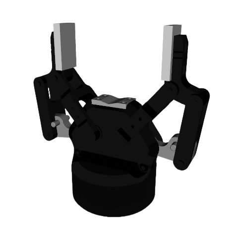

# Robotiq Gripper Description

FaSim wrapper around the official ROS 2 `robotiq_description` package (currently 2F-85).
Meshes and kinematics come from the system package; this package exposes FaSim naming
(`gripper_base` / `gripper_joint`, optional name prefix) for arm integration.

## Collider / planning

| Mode | Meaning |
|------|---------|
| `collider:=convex` (default) | Official mesh collisions |
| `collider:=simple` | Cylinder/box envelope for OCS2 self-collision |
| `kinematic_only:=true` | Omit finger DOF; keep base envelope + `eef` (planning URDF) |

Planning launches inject `collider:=simple` and `eef_fixed_joints:=true` via `robot_common_launch`.

## Dependencies

```bash
sudo apt install ros-${ROS_DISTRO}-robotiq-description
```

## Build

```bash
colcon build --packages-up-to robotiq_gripper_description --symlink-install
```

## Visualize

```bash
ros2 launch robot_common_launch gripper.launch.py gripper:=robotiq_gripper
```


